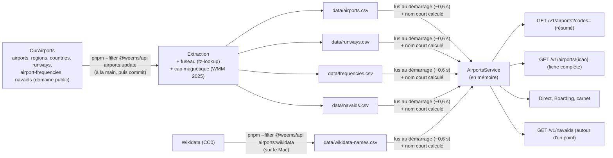

# 023 — Aéroports : tous les champs OurAirports, pistes, fréquences, balises radio et noms Wikidata

Date : 14/11/2026. Complète la fiche [005](005-liste-aeroports-ourairports.md) (liste OurAirports dans un fichier de l'API). Demande de Greg du 14/11 (fil « Ajouter les noms des aéroports »).

## Contexte

La liste des aéroports de l'API n'avait que `icao,lat,lon,name`. Il fallait un nom lisible dans une liste ou un tableau (« Marseille Provence » plutôt que « Marseille Provence Airport »), le code IATA, le pays, et l'altitude du terrain pour l'analyse d'approche à venir. Le site raccourcissait lui-même les noms de la liste des vols (`shortAirportName`).

## Options

| Option | Pour | Contre |
| --- | --- | --- |
| A. Champs ajoutés au fichier, nom court calculé à la lecture | Aucune base, aucune migration ; une seule règle de nom court, dans l'API | Fichier un peu plus gros (2,1 → 2,5 Mo) |
| B. Nom court stocké dans le fichier | Lecture un peu plus simple | Donnée déduite stockée deux fois ; fichier de 3,4 Mo |
| C. Table PostgreSQL | Requêtes SQL, corrections depuis la console | Migration et chargement dans chaque environnement, sans besoin aujourd'hui (fiche 005) |
| D. Ville OurAirports (`municipality`) | Semble naturelle | Inutilisable telle quelle : LFML = « Marignane, Bouches-du-Rhône », LFPG = « Paris (Roissy-en-France, Val-d'Oise) » ; 3 612 villes bruitées, 4 193 vides |

## Choix

A, sans la ville. Le 14/11, Greg a demandé **tous les champs gratuits** d'OurAirports, pistes comprises (« on fera le ménage des champs non utilisés à la fin ») : ils sont tous gardés, même sans écran prévu.

Trois fichiers dans `apps/api/data/`, CSV avec guillemets quand un champ contient une virgule ou un guillemet (`modules/airports/csv.ts`) :

| Fichier | Une ligne par | Champs |
| --- | --- | --- |
| `airports.csv` (6,6 Mo, 46 712) | code saisi dans le tracker | `icao`, `ident` (identifiant OurAirports, clé des deux autres fichiers), `lat`, `lon`, `elevationFt`, `iata`, `country`, `timezone`, `type`, `continent`, `region`, `regionName`, `scheduledService`, `name`, `wikipediaLink`, `homeLink`, `keywords` |
| `runways.csv` (2,8 Mo, 40 837) | piste | `airport` (ident), `lengthFt`, `widthFt`, `surface`, `lighted`, `closed`, et pour chaque seuil `a.` / `b.` : `ident`, `lat`, `lon`, `elevationFt`, `headingTrueDeg`, `headingMagneticDeg`, `displacedThresholdFt` |
| `frequencies.csv` (0,7 Mo, 29 235) | fréquence | `airport` (ident), `type`, `description`, `mhz` |
| `navaids.csv` (1,1 Mo, 11 008, monde entier) | balise | `ident`, `name`, `type` (VOR, VOR-DME, VORTAC, DME, NDB, NDB-DME, TACAN), `frequencyKhz`, position, `elevationFt`, `country`, DME associé (`dme.*` : fréquence, canal, position, altitude), `slavedVariationDeg`, `magneticVariationDeg`, `usage`, `power`, `airport` (ident) |
| `wikidata-names.csv` (facultatif) | code OACI | `nameFr`, `cityEn`, `cityFr` (ville desservie, propriété P931) |

- `elevationFt` : altitude du terrain en pieds, vide si OurAirports ne la donne pas (1 870 aéroports).
- `iata` : code à 3 caractères, vide sinon (environ 9 100 aéroports en ont un).
- `country` : code ISO 3166-1 alpha-2 ; le site écrira le pays dans la langue de la page (`Intl.DisplayNames`), sans table des pays.
- `timezone` : fuseau IANA calculé à l'import depuis la position (`@photostructure/tz-lookup`, fiche 004).
- `regionName` et `countryName` : noms anglais pris dans `regions.csv` et `countries.csv` d'OurAirports.
- Noms Wikidata (CC0) : la requête SPARQL (`wikidata-names.ts`) prend tout élément qui a un code OACI (P239), son libellé français et le libellé de la ville desservie. `query.wikidata.org` est bloqué depuis l'environnement de Claude : `pnpm --filter @weems/api airports:wikidata` se lance **sur le Mac**, puis on commite le fichier. Sans fichier, les noms valent `null`.
- Balises : liées à leur aéroport dans `GET /v1/airports/{icao}` (`navaids`), et route publique `GET /v1/navaids?lat=&lon=&radiusNm=` (250 NM au plus, 200 balises au plus, les plus proches d'abord).
- `headingMagneticDeg` : cap vrai moins la déclinaison du modèle magnétique mondial WMM 2025-2030 (`magvar`, MIT) au seuil, **à la date de l'import** : la déclinaison dérive d'environ 0,1° par an, d'où une mise à jour au moins annuelle.
- `shortName` : calculé à la lecture (`shortAirportName`) : le nom sans « Airport », « International Airport », « Airfield », « Aerodrome », « Airstrip » en fin de nom ; « Regional », « Air Base » restent ; jamais vide.
- Contrat (`packages/contrats`) : `Airport` (résumé : nom, nom court, nom français, ville, IATA, pays, altitude, fuseau, position) pour `GET /v1/airports?codes=`, le direct, le Boarding et le carnet ; `AirportDetail` (tout, avec `runways`, `frequencies` et `navaids`) ; `Navaid` pour la nouvelle route publique `GET /v1/airports/{icao}`.
- La liste des vols du carnet (`GET /v1/me/logbook/list`) renvoie le nom court ; la règle du site est supprimée.
- Monde entier, pas de limite par pays ni par continent : un pilote MSFS vole partout.
- Écartés : ville OurAirports (bruitée, remplacée par Wikidata) ; METAR (service en direct, sujet de la fiche « conditions et atterrissage ») ; OpenAIP (espaces aériens, licence non commerciale) ; OpenStreetMap (ODbL, écarté par Greg pour le fond du site) ; FAA CIFP (procédures des États-Unis, domaine public) et relief SRTM/Copernicus : gratuits mais gros chantiers, pour le jour des cartes d'approche.

## Conséquences

- Mise à jour : `pnpm --filter @weems/api airports:update` (4 téléchargements, quelques secondes), au moins une fois par an pour les caps magnétiques, puis commit des trois fichiers. Aucune IA, aucune clé, aucun appel extérieur pendant le fonctionnement de l'API.
- Ménage à la fin : les champs sans écran (`homeLink`, `keywords`, `continent`, fréquences…) seront retirés avant la mise en ligne s'ils ne servent toujours pas (demande de Greg).
- Passer à une table PostgreSQL (option C) quand l'un de ces besoins apparaît : recherche par nom côté serveur, corrections depuis la console, statistiques en SQL par pays, mise à jour sans redéployer. Le même fichier servira de source.
- Le générateur du simulateur (`apps/tracker/tools/generate-flights`) garde sa propre extraction des pistes : à faire lire les fichiers de l'API (ou un paquet partagé) quand on y touchera, pour n'avoir qu'une lecture d'OurAirports.
- Le Boarding garde le nom complet dans sa bulle tant que Greg n'a pas choisi entre nom court seul et nom court + IATA.
