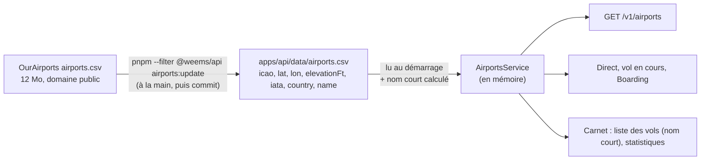

# 023 — Aéroports : code IATA, pays, altitude et nom court

Date : 14/11/2026. Complète la fiche [005](005-liste-aeroports-ourairports.md) (liste OurAirports dans un fichier de l'API). Demande de Greg du 14/11 (fil « Ajouter les noms des aéroports »).

## Contexte

La liste des aéroports de l'API n'avait que `icao,lat,lon,name`. Il fallait un nom lisible dans une liste ou un tableau (« Marseille Provence » plutôt que « Marseille Provence Airport »), le code IATA, le pays, et l'altitude du terrain pour l'analyse d'approche à venir. Le site raccourcissait lui-même les noms de la liste des vols (`shortAirportName`).

## Options

| Option | Pour | Contre |
| --- | --- | --- |
| A. Champs ajoutés au fichier, nom court calculé à la lecture | Aucune base, aucune migration ; une seule règle de nom court, dans l'API | Fichier un peu plus gros (2,1 → 2,5 Mo) |
| B. Nom court stocké dans le fichier | Lecture un peu plus simple | Donnée déduite stockée deux fois ; fichier de 3,4 Mo |
| C. Table PostgreSQL | Requêtes SQL, corrections depuis la console | Migration et chargement dans chaque environnement, sans besoin aujourd'hui (fiche 005) |
| D. Ville OurAirports (`municipality`) | Semble naturelle | Inutilisable telle quelle : LFML = « Marignane, Bouches-du-Rhône », LFPG = « Paris (Roissy-en-France, Val-d'Oise) » ; 3 612 villes bruitées, 4 193 vides |

## Choix

A, sans la ville.

- Fichier `apps/api/data/airports.csv` : `icao,lat,lon,elevationFt,iata,country,name`, CSV avec guillemets quand un champ contient une virgule ou un guillemet (lu par le même découpage que le fichier OurAirports).
- `elevationFt` : altitude du terrain en pieds, arrondie ; vide si OurAirports ne la donne pas (1 870 aéroports).
- `iata` : code à 3 caractères, vide sinon (environ 9 100 aéroports en ont un).
- `country` : code ISO 3166-1 alpha-2 ; le site écrira le pays dans la langue de la page (`Intl.DisplayNames`), sans table des pays.
- `shortName` : calculé à la lecture (`shortAirportName`, `modules/airports/ourairports.ts`) : le nom sans « Airport », « International Airport », « Airfield », « Aerodrome », « Airstrip » en fin de nom ; « Regional », « Air Base » restent ; jamais vide.
- Le contrat `Airport` (`packages/contrats`) porte ces quatre champs : `GET /v1/airports`, la route du direct et la page d'un vol en cours les reçoivent.
- La liste des vols du carnet (`GET /v1/me/logbook/list`) renvoie le nom court ; la règle du site est supprimée.
- Monde entier, pas de limite par pays ni par continent : un pilote MSFS vole partout.

## Conséquences

- Mise à jour inchangée : `pnpm --filter @weems/api airports:update`, environ une fois par trimestre, puis commit du fichier. Aucune IA, aucune clé.
- Passer à une table PostgreSQL (option C) quand l'un de ces besoins apparaît : recherche par nom côté serveur, corrections depuis la console, statistiques en SQL par pays, mise à jour sans redéployer. Le même fichier servira de source.
- Étape suivante prévue, non faite ici : les pistes (`runways.csv` d'OurAirports, même licence) quand l'analyse d'approche démarrera, avec une seule extraction OurAirports partagée entre l'API et le générateur du simulateur (aujourd'hui chacun a son découpage CSV).
- Le Boarding garde le nom complet dans sa bulle tant que Greg n'a pas choisi entre nom court seul et nom court + IATA.
