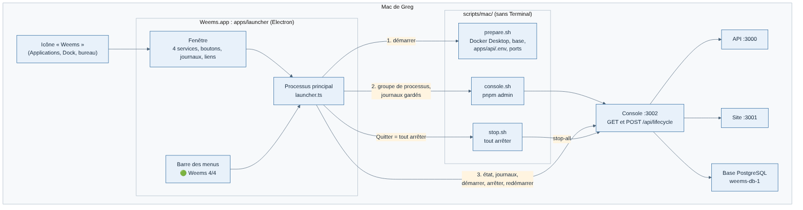

# Démarrer et arrêter Weems sur le Mac

Une seule icône, **Weems** : elle ouvre une petite application qui démarre tout, montre l'état de chaque service et ses journaux, et arrête tout quand on la quitte. Aucune fenêtre Terminal. Choix expliqué dans `../decisions/020-lanceur-mac.md` (l'app remplace les icônes Weems Start et Weems Stop de la fiche 011).



## Installer l'app (une fois, puis à chaque mise à jour du lanceur)

Dans un Terminal, depuis la racine du dépôt (`~/Projets/weems-code`) :

```bash
bash scripts/mac/install-launcher.sh
```

Le script construit `Weems.app` (une à deux minutes), la signe localement, l'installe dans Applications, pose un raccourci **Weems** sur le bureau, met `Weems Start.command` et `Weems Stop.command` à la corbeille, puis ouvre l'app. Si Weems est déjà ouverte, il demande de la quitter d'abord. Pour l'avoir dans le Dock : clic droit sur l'icône du Dock pendant qu'elle tourne › Options › Garder dans le Dock.

## Utiliser l'app

| Geste | Effet |
| --- | --- |
| Ouvrir Weems | Démarre ce qui est arrêté : Docker Desktop, la base, la console, puis l'API et le site |
| Boutons d'une ligne | Démarrer, arrêter ou redémarrer la base, l'API ou le site |
| Boutons de la ligne Console | Agissent sur tout : l'API et le site dépendent de la console |
| Barre du haut, de gauche à droite | Boutons **Site** et **Console**, fond bleu canard avec icône (ouvrent http://localhost:3001/fr et http://127.0.0.1:3002/services), icônes **Docker** et **VS Code** (Docker Desktop, le dépôt dans VS Code), icônes orange accolées **Tout arrêter** (carré) et **Tout redémarrer** (flèche), chacune après un avertissement à confirmer (« Tout démarrer », avec son texte, quand rien ne tourne ; aussi dans le menu de la barre des menus, sans avertissement). La simulation de trafic et d'activité se lance depuis la console |
| Six cartes à droite, avec un cercle de progression chacune, de même taille, en haut à droite | En haut, **Utilisateurs** et **Revenu total** (détaillés plus loin). Dessous, **Base de données** et **Fichiers**, deux demi-cartes l'une au-dessus de l'autre : taille de la base, migrations, nombre de vols (cercle : part des 20 Go du serveur alpha) ; sauvegardes de la console, nombre et date de la dernière (cercle : part du disque du Mac utilisée). **API** et **En direct**, aussi empilées : temps de réponse p95 et erreurs 5xx sur 24 h (cercle : p95 rapporté au seuil de lenteur de 500 ms) ; vols en direct, dont simulés, et positions par minute (cercle : vols en direct rapportés aux 500 tenus par le test de charge J4). **Utilisateurs** actifs, comptes fictifs compris et comptés à part (cercle : objectif des 500 places fondateurs). **Revenu total**, fictif tant qu'il n'y a pas de paiement : 2,40 € par compte actif, 0,60 € ce mois-ci, 0,50 € le mois dernier, flèche de tendance (cercle : revenu du mois rapporté au budget de 100 € par mois). Les cercles des ressources passent à l'orange après 80 %, au rouge après 95 %. Lues toutes les 10 s par la console (`GET /api/overview`, tirée de la page Supervision et des fichiers du Mac) ; « — » quand la console ou l'API ne répond pas |
| Journaux | Un onglet par service ; l'onglet Console montre aussi les étapes de démarrage et d'arrêt |
| Fermer la fenêtre | Weems continue : pastille « 🟢 Weems 4/4 · mois 77 € · total 307 € » dans la barre des menus (gains fictifs tant qu'il n'y a pas de paiement, au centime dans son menu), menu pour rouvrir la fenêtre |
| Quitter (⌘Q ou menu de la barre) | Arrête tout, base comprise, sans effacer de données |

Les étapes de démarrage sont celles de l'ancienne icône Start, dans `scripts/mac/prepare.sh` : Docker Desktop (jusqu'à 3 minutes d'attente), arrêt de l'ancien conteneur `weems-api-1`, base (`docker compose up -d db`), vérification de `apps/api/.env` (créé ou corrigé vers la base `weems`, ancien fichier gardé en `.env.bak-<date>`), ports 3000 à 3002 (un vieux Weems est arrêté, un programme étranger n'est **jamais** arrêté : le démarrage s'arrête et le nomme).

## Comment ça marche

| Fichier | Rôle |
| --- | --- |
| `apps/launcher/` | L'app Electron (voir son `CLAUDE.md`) |
| `scripts/mac/prepare.sh` | Tout ce qui précède la console |
| `scripts/mac/console.sh` | La console (`pnpm admin`) avec les outils de `mise` |
| `scripts/mac/stop.sh` | Tout arrêter (aussi utilisé par l'app quand on la quitte) |
| `scripts/mac/lib.sh` | Partagé : outils de `mise` (une app ouverte depuis le Finder n'a pas `~/.zshrc`), Docker, ports, arrêt complet |
| `scripts/mac/install-launcher.sh` | Construction et installation de `Weems.app` |
| `apps/admin/src/app/api/lifecycle/route.ts` | `GET` (état, journaux d'un service) et `POST` (tout ou un service), format `@weems/contrats` |

La route de la console exige l'en-tête `x-weems-local-script: 1` : une page web ne peut pas l'ajouter sans une requête préalable CORS, que la console refuse. Elle reste derrière le contrôle d'adresse de `src/proxy.ts` (127.0.0.1:3002 seulement).

Fichier de travail : `apps/admin/.data/console.pid` (groupe de processus de la console lancée par l'app), jamais versionné.

## Sans l'app (dépannage, en Terminal)

`bash scripts/mac/start.sh` fait le même démarrage dans la fenêtre Terminal (à laisser ouverte, Ctrl-C arrête tout) ; `bash scripts/mac/stop.sh` arrête tout, y compris une console lancée par l'app. Les anciennes icônes se reposent avec `bash scripts/mac/install-desktop-icons.sh`.

## En cas de problème

| Message | Que faire |
| --- | --- |
| `node introuvable` ou `pnpm introuvable` (onglet Console) | `mise install node@24 pnpm@10.28.0` dans un Terminal, puis rouvrir Weems |
| `Docker Desktop introuvable` | Installer Docker Desktop dans Applications |
| `Port 300x pris par « … »` | Fermer ce programme (ce n'est pas Weems), puis « Tout démarrer » |
| « La console s'est arrêtée au démarrage » | Lire l'onglet Console ; souvent `pnpm install` à refaire après une mise à jour du dépôt |
| « Lancé hors de la console » | Un service lancé à la main dans un Terminal : l'arrêter là-bas |
| L'app ne s'ouvre pas après une mise à jour | Relancer `bash scripts/mac/install-launcher.sh` |
