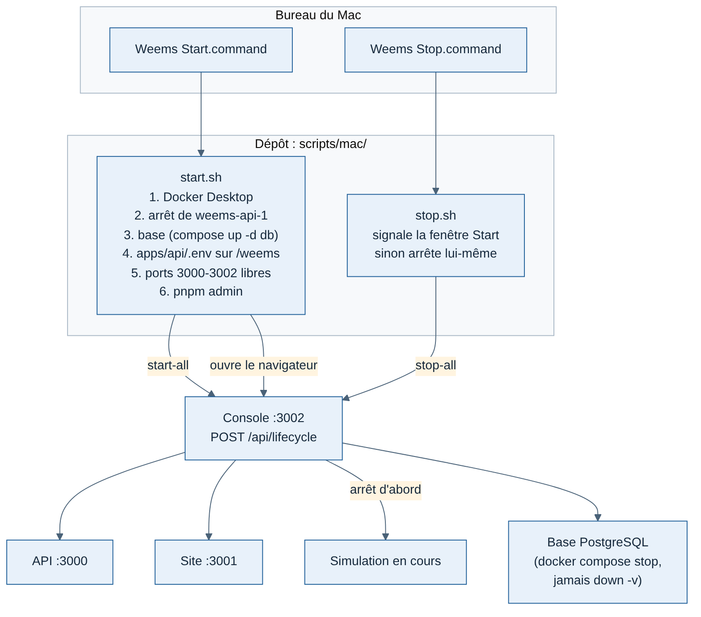

# Démarrer et arrêter Weems sur le Mac

Deux icônes sur le bureau : **Weems Start** lance tout, **Weems Stop** arrête tout. Elles remplacent les quatre onglets de Terminal du `README.md` (qui restent valables). Choix expliqué dans `../decisions/011-demarrage-par-icones.md`.



## Installer les icônes (une fois)

Dans un Terminal, depuis la racine du dépôt :

```bash
bash scripts/mac/install-desktop-icons.sh
```

Le script pose `Weems Start.command` et `Weems Stop.command` sur le bureau. Ce sont des lanceurs de trois lignes vers `scripts/mac/` : une mise à jour du dépôt suffit, sans réinstaller. Si le dépôt change de dossier, relancer la commande.

## Weems Start

Une fenêtre de Terminal s'ouvre et :

1. démarre Docker Desktop s'il ne tourne pas (jusqu'à 3 minutes d'attente) ;
2. arrête l'ancien conteneur `weems-api-1`, qui garde le port 3000 sans que `lsof` le voie ;
3. démarre la base (`docker compose up -d db`) et attend qu'elle réponde ;
4. vérifie que `apps/api/.env` vise la base `weems` : le crée depuis `.env.example` s'il manque, sinon corrige `DATABASE_URL` et garde l'ancien fichier en `.env.bak-<date>` ;
5. vérifie les ports 3000, 3001 et 3002 : un programme Weems oublié est arrêté, un programme étranger n'est **jamais** arrêté (le script s'arrête et le nomme) ;
6. lance la console (`pnpm admin`), qui démarre elle-même l'API et le site : ils apparaissent « lancés par la console » et ses boutons peuvent les arrêter ;
7. ouvre le navigateur sur http://127.0.0.1:3002/services.

Laisser cette fenêtre ouverte : elle affiche les journaux de la console. La fermer, ou faire Ctrl-C dedans, arrête tout comme l'icône Stop. Un deuxième double-clic sur Start rouvre seulement la console.

## Weems Stop

Dans l'ordre : la simulation en cours (ses vols sont fermés comme interrompus), le site, l'API, la console, puis la base (`docker compose stop`). Les données sont gardées : jamais `docker compose down -v`. Docker Desktop reste ouvert.

Si la console ne répond plus (fenêtre fermée de force, plantage), Stop retrouve les programmes Weems restés seuls par les ports 3000 à 3002 et les simulations, en vérifiant que leur dossier de travail est dans le dépôt.

## Comment ça marche

| Fichier | Rôle |
| --- | --- |
| `scripts/mac/lib.sh` | Partagé : outils de `mise` (les `.command` s'ouvrent sans `~/.zshrc`), Docker, ports, arrêt complet |
| `scripts/mac/start.sh`, `stop.sh` | Les deux icônes |
| `scripts/mac/check-api-env.sh` | Vérification de `apps/api/.env` |
| `scripts/mac/install-desktop-icons.sh` | Pose des lanceurs sur le bureau |
| `apps/admin/src/app/api/lifecycle/route.ts` | `POST { action: "start-all" \| "stop-all" }`, appelé par les scripts |

La route de la console exige l'en-tête `x-weems-local-script: 1` : une page web ne peut pas l'ajouter sans une requête préalable CORS, que la console refuse. Elle reste derrière le contrôle d'adresse de `src/proxy.ts` (127.0.0.1:3002 seulement).

Fichiers de travail : `apps/admin/.data/start.pid` (fenêtre Start) et `console.pid` (groupe de processus de la console), jamais versionnés.

## En cas de problème

| Message | Que faire |
| --- | --- |
| `node introuvable` ou `pnpm introuvable` | `mise install node@24 pnpm@10.28.0` dans un Terminal, puis relancer |
| `Docker Desktop introuvable` | Installer Docker Desktop dans Applications |
| `Port 300x pris par « … »` | Fermer ce programme (ce n'est pas Weems), puis relancer |
| La console s'arrête au démarrage | Lire les lignes au-dessus dans la fenêtre ; souvent `pnpm install` à refaire après une mise à jour du dépôt |
