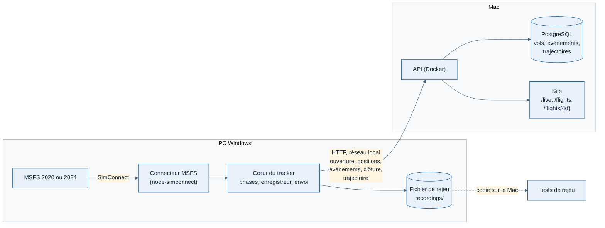

# Guide J2 : premier vrai vol depuis le PC Windows

Rédigé le 11/11/2026. But : faire voler MSFS sur le PC, enregistrer le vol avec `pnpm fly` et l'envoyer à l'API qui tourne sur le Mac, en réseau local. Spécification : [spec J2](../cahiers-des-charges/spec-J2-premier-vrai-vol.md).



Chaque bloc de commandes indique où le coller :

- **Mac** : application Terminal ;
- **PC** : PowerShell, ouvert depuis le menu Démarrer en tapant « PowerShell ».

Les étapes A et B ne se font qu'une fois. Les étapes C, D et E se refont à chaque séance de vol.

## A. Préparer le Mac (une fois)

### A1. Récupérer la branche J2 et relancer l'API

Onglet Terminal 1 (Mac) :

```bash
cd ~/Projets/weems-code
git checkout main
git pull
pnpm install
cd apps/api
docker compose up --build -d
```

Attendre une minute, puis vérifier que l'API répond :

```bash
curl http://localhost:3000/v1/health
```

Réponse attendue : une ligne qui contient `"status":"ok"`.

### A2. Trouver l'adresse du Mac sur le réseau

Toujours sur le Mac :

```bash
ipconfig getifaddr en0 || ipconfig getifaddr en1
```

La réponse ressemble à `192.168.1.23`. **Noter cette adresse** : elle remplace `ADRESSE-DU-MAC` dans toute la suite.

### A3. Pare-feu du Mac

Réglages Système → Réseau → Coupe-feu.

- S'il est désactivé, rien à faire.
- S'il est activé : Options… → ajouter Docker (s'il n'y est pas) → « Autoriser les connexions entrantes ».

## B. Préparer le PC (une fois)

### B1. Installer Git et mise (le même gestionnaire d'outils que sur le Mac)

PowerShell (PC) :

```powershell
winget install --id Git.Git -e
winget install --id jdx.mise -e
```

**Fermer PowerShell et en rouvrir un**, pour que les nouvelles commandes soient trouvées.

### B2. Installer Node.js 24 et pnpm

PowerShell (PC) :

```powershell
mise use -g node@24 pnpm@10.28.0
[Environment]::SetEnvironmentVariable("Path", [Environment]::GetEnvironmentVariable("Path", "User") + ";$env:LOCALAPPDATA\mise\shims", "User")
```

Fermer PowerShell, en rouvrir un, puis vérifier :

```powershell
node -v
pnpm -v
```

Réponses attendues : `v24.…` et `10.28.0`.

**Si `node -v` ne répond pas `v24…`**, il faut une autre méthode :

1. Télécharger l'installateur « Node.js 24 LTS » pour Windows sur nodejs.org et l'installer.
2. Rouvrir PowerShell, puis lancer : `npm install -g pnpm@10.28.0`.

### B3. Vérifier que le PC voit l'API du Mac

PowerShell (PC), en remplaçant `ADRESSE-DU-MAC` :

```powershell
curl.exe http://ADRESSE-DU-MAC:3000/v1/health
```

La réponse doit contenir `"status":"ok"`.

Si la commande échoue ou reste bloquée :

- le PC et le Mac sont-ils sur le même réseau (même box) ?
- le pare-feu du Mac (étape A3) laisse-t-il passer Docker ?
- l'API tourne-t-elle encore sur le Mac (étape A1) ?

### B4. Cloner le dépôt et installer

PowerShell (PC) :

```powershell
cd $HOME
git clone https://github.com/tetardo/weems.git weems-code
cd weems-code
pnpm install
```

Vérifier que tout fonctionne sur le PC (environ 1 minute, sans MSFS) :

```powershell
pnpm exec vitest run --project tracker
```

Réponse attendue : `Tests … passed`, aucun `failed`.

## C. À chaque séance de vol

1. **Mac** : vérifier que l'API tourne (`curl http://localhost:3000/v1/health`). Sinon, reprendre l'étape A1 à partir de `cd apps/api`.
2. **PC**, PowerShell : mettre le code à jour.

   ```powershell
   cd $HOME\weems-code
   git pull
   pnpm install
   ```

3. **PC** : lancer MSFS et attendre le menu principal.
4. **PC**, PowerShell : lancer le tracker. Remplacer l'adresse, et les aéroports par ceux du vol.

   ```powershell
   cd $HOME\weems-code\apps\tracker
   pnpm fly --api http://ADRESSE-DU-MAC:3000 --from LFPG --to LFBO
   ```

   Le tracker affiche `En attente de MSFS…`, puis `Simulateur connecté.` et le nom de l'avion.
5. Préparer le vol dans MSFS et voler normalement. Le vol s'ouvre au premier démarrage moteur ou au repoussage. Ensuite, une ligne s'affiche à chaque changement de phase (`phase TAXI_OUT`, `phase TAKEOFF`…).
6. **Fin du vol** : au parking, frein de parc serré, moteurs coupés. Après 10 secondes, la phase passe à `ARRIVED` et le vol est clos.
   - Si le vol ne se clôt pas tout seul, taper `fin` puis Entrée.
   - **Noter ce cas** : c'est une information utile pour le réglage des phases.
7. Attendre `0 message(s) en attente`, puis quitter avec Ctrl+C.

Bon à savoir :

- Un Ctrl+C en plein vol ne perd rien. Si on relance `pnpm fly` dans les 30 minutes, avec le même avion et à moins de 5 NM, le même vol reprend.
- Chaque séance est aussi écrite dans `apps\tracker\recordings\` sur le PC. Ces fichiers permettent de rejouer les vols sur le Mac.

## D. Vérifier qu'un vol est arrivé

Mac, Terminal :

```bash
curl -s "http://localhost:3000/v1/flights?limit=5" -H "Authorization: Bearer dev-token"
```

Le vol apparaît en premier, avec son temps bloc.

Pour le voir sur le site, onglet Terminal 2 (Mac) :

```bash
cd ~/Projets/weems-code
pnpm --filter @weems/web dev
```

Puis ouvrir http://localhost:3001/fr/flights dans le navigateur et cliquer sur le vol : carte de la trajectoire, profil vertical, phases, atterrissage et journal.

## E. Les 10 vols de référence

À faire dans l'ordre qui vous arrange, 30 à 60 minutes chacun. Pour chaque vol, noter :

- le numéro du vol ;
- ce qui a surpris ;
- si le vol s'est clos tout seul.

Les notes vont dans `docs/suivi/vols-de-reference-j2.md`, ou directement dans ce fil de discussion.

| # | Vol | Avion | Ce qu'il faut faire | Ce que le tracker doit voir |
| --- | --- | --- | --- | --- |
| 1 | Tour de piste | C172 | Décollage, un tour, atterrissage complet | Phases courtes, vol clos au parking |
| 2 | LFPG → LFBO | A320 | Vol normal | Toutes les phases dans l'ordre |
| 3 | Avec remise des gaz | A320 | Remettre les gaz en finale, puis atterrir | Remise des gaz au journal |
| 4 | Avec pause | A320 | 5 minutes de pause en croisière (touche Échap) | Pause au journal, retirée des temps |
| 5 | Avec accélération du temps | A320 | ×4 pendant 5 minutes en croisière | **Pas encore détectée** (voir plus bas) : noter l'heure de début et de fin |
| 6 | Décollage interrompu | A320 | Interrompre vers 80 kt, retourner au seuil, repartir | Décollage interrompu au journal |
| 7 | Atterrissage avec rebond | C172 | Arrondi trop haut, rebond | Rebond au journal |
| 8 | Départ en vol | Au choix | Démarrer le vol de MSFS « en vol » | Vol ouvert en l'air |
| 9 | Changement d'avion | Au choix | Au parking, moteurs tournants, charger un autre avion | Vol clos « avion changé » |
| 10 | MSFS 2024 | A320 | Vol normal sous MSFS 2024 (les autres sous 2020, ou l'inverse) | Version reconnue |

### À observer pendant les premiers vols

Ces réglages ont été choisis d'après la documentation, sans pouvoir être testés. Les vols de référence les confirment. Détail dans [pieges.md](../../apps/tracker/docs/reference/pieges.md).

- **Au repoussage** : le vol doit s'ouvrir. S'il s'ouvre dès le chargement de l'avion, moteurs éteints, le signaler.
- **Assiette et inclinaison** : nous les vérifierons sur les rejeux, rien à faire en vol.
- **Accélération du temps** : pas encore lue, car la variable n'est pas vérifiée dans la doc SDK. Pour l'ajouter, lancer une fois sur le PC `bash scripts/update-msfs-docs.sh` (depuis `apps\tracker`, avec Git Bash), puis le signaler.

## F. Mesurer les images par seconde (une fois)

1. Dans MSFS : Options → Général → Développeurs → Mode développeur : activé.
2. Dans la barre du haut : Options → Afficher les images par seconde.
3. En croisière, noter la valeur moyenne pendant 1 minute **avec** `pnpm fly` lancé.
4. Quitter `pnpm fly` (Ctrl+C), attendre 1 minute, puis noter la valeur **sans**.

Critère de la spec : moins de 5 % d'écart.

## G. En fin de séance : copier les rejeux sur le Mac

Copier les fichiers de `apps\tracker\recordings\` du PC (clé USB ou dossier partagé) dans `~/Projets/weems-code/apps/tracker/recordings/` sur le Mac.

Ces fichiers ne vont jamais dans le dépôt GitHub (dossier ignoré par git) : ce sont des données de vol.
