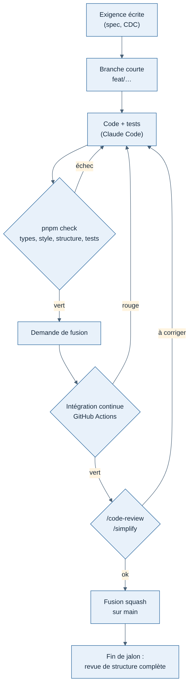

# Règles de développement

Rédigées le 11/11/2026, avant la première ligne de code. Elles valent pour tout le dépôt et pour toute personne ou tout agent qui code : Greg, Claude, puis Houssine ou Thibault s'ils contribuent.

But : garder un code fiable alors que Greg code seul avec Claude, sans relecteur humain.

## 1. Définition de « terminé »

Une modification n'est terminée que si **tous** ces points sont vrais :

1. Elle répond à une exigence écrite (cahier des charges ou spécification), citée dans la demande de fusion.
2. Elle respecte les règles de structure (section 4) et l'analyse automatique de structure passe.
3. Elle est couverte par des tests automatiques qui échouaient avant et passent après.
4. La vérification des types, le contrôle du style et tous les tests passent, sur le Mac et dans l'intégration continue.
5. Elle a été relue par Claude (`/code-review`), avec `/security-review` si elle touche la connexion, les droits, les données personnelles ou les entrées venant de l'extérieur.
6. La documentation concernée est à jour : spécification, `CLAUDE.md` de l'application, `README.md` si l'usage change.
   Une fonction visible par le pilote, nouvelle ou modifiée, met aussi à jour le catalogue des formules (clé, ligne, textes : fiche [015](../decisions/015-catalogue-des-formules.md)) : la page Offres en dépend. Voir les règles permanentes de la section 12.
   L'index [`docs/README.md`](../README.md) liste tout document ajouté, et un document dépassé part dans `docs/archives/` (voir [archives/README.md](../archives/README.md)).
7. Elle tourne sur le Mac de Greg (sauf le connecteur MSFS, testé sur le PC Windows).

## 2. Branches et fusions

- `main` est toujours dans un état qui fonctionne. On n'y pousse jamais directement.
- Une branche courte par sujet (`feat/flights-api`, `fix/phase-bounce`), fusionnée par une demande de fusion (pull request), même quand Greg travaille seul : c'est ce qui déclenche l'intégration continue et la relecture.
- Fusion en un seul commit (squash), avec un message qui dit ce qui change et pourquoi.
- Messages de commit : préfixe en anglais (`feat`, `fix`, `docs`, `test`, `chore`), description en français.
  Exemple : `feat(api): réception des événements de vol sans doublon`.
- Protection de `main` sur GitHub : fusion seulement si l'intégration continue est verte.

## 3. Outils communs

| Sujet | Choix | Pourquoi |
| --- | --- | --- |
| Node.js | Version 24 (LTS), fixée dans `.nvmrc` | La même sur le Mac, le PC et l'intégration continue |
| Gestion du dépôt | pnpm avec espaces de travail (`apps/*`, `packages/*`) [Confiance moyenne] | Gère proprement les paquets partagés d'un dépôt unique, rapide, économe en disque |
| TypeScript | Version 6, mode strict renforcé (`tsconfig.base.json`), aucun `any` | Les erreurs de type sont la première protection quand personne ne relit |
| Style | ESLint et Prettier, appliqués automatiquement | Aucun débat de forme, diff lisibles |
| Tests | Vitest partout | Un seul outil à connaître |
| Formats partagés | Zod dans `packages/contrats` | Une seule définition pour le tracker, l'API et le site |

Une commande à la racine lance tout : `pnpm check` (types, style, analyse de structure, tests). Les réglages sont dans `eslint.config.js`, `.dependency-cruiser.cjs`, `.jscpd.json` et `knip.json`.

## 4. Structure du code

Exigence de Greg (11/11/2026) : un code **organisé**, pas des morceaux collés bout à bout. Elle se traduit en règles vérifiables, contrôlées par des outils, pas seulement par la bonne volonté.

**Règles d'organisation**

- Chaque application suit l'organisation écrite dans son `CLAUDE.md` (par exemple routes, logique métier et accès à la base séparés dans l'API ; cœur indépendant dans le tracker). On n'ajoute pas un fichier « où il y a de la place » : on le met là où l'organisation le prévoit, ou on la fait évoluer explicitement.
- Un fichier a une seule responsabilité. Au-delà d'environ 300 lignes, on le découpe.
- Une fonction fait une chose. Au-delà d'environ 50 lignes ou de 3 niveaux d'imbrication, on la découpe.
- Pas de copier-coller : un code utilisé deux fois devient une fonction ; utilisé par deux applications, il va dans `packages/`.
- Pas de code mort, pas de code commenté laissé « au cas où » : git garde l'historique.
- Noms explicites en anglais : un nom dit ce que fait la chose, sans abréviation obscure.
- Avant d'écrire, chercher si le dépôt a déjà ce qu'il faut ; étendre plutôt que dupliquer.

**Analyse de structure automatique** (dans `pnpm check` et dans l'intégration continue, un échec bloque la fusion)

| Outil | Ce qu'il vérifie |
| --- | --- |
| dependency-cruiser | Les frontières entre modules : le cœur du tracker n'importe rien de l'extérieur, un module de l'API ne touche pas la base d'un autre, aucune dépendance circulaire |
| ESLint (règles de taille et de complexité) | Fichiers, fonctions et imbrications trop longs, complexité excessive |
| jscpd | Code dupliqué entre fichiers |
| knip | Fichiers, exports et dépendances inutilisés |

**Revue de structure humaine et par Claude**

- À chaque demande de fusion : `/code-review` et `/simplify` vérifient aussi que le code est rangé au bon endroit.
- À la fin de chaque jalon : une revue de structure complète du dépôt (Claude, compétence d'analyse de dette technique), avec un compte rendu dans `docs/revues/`. Les corrections passent avant le jalon suivant.
- Si Thibault ou Houssine sont disponibles, une relecture humaine de l'organisation à la fin de J0 : c'est le moment où elle se fige.

## 5. Tests

| Partie | Ce qui doit être testé | Comment |
| --- | --- | --- |
| Cœur du tracker | Chaque transition de phase, chaque cas particulier de la spec T0, chaque règle de notation | Vols synthétiques et vols rejoués, sans simulateur |
| Connecteur MSFS | Conversions d'unités, valeurs absentes, événements | Données enregistrées sur le PC, rejouées sur le Mac |
| API | Chaque route : cas normal, renvoi en double, données invalides, droits | Vraie base PostgreSQL dans Docker, jamais de base simulée |
| Site web | Les parcours principaux (carnet, page de vol, carte) | Tests de navigateur automatisés, à partir de J2 |

Pas d'objectif de pourcentage de couverture : il pousse à écrire des tests inutiles. La règle est qualitative : **chaque exigence a au moins un test, chaque bogue corrigé reçoit le test qui l'aurait détecté.**

## 6. Intégration continue (GitHub Actions)

À chaque demande de fusion et à chaque fusion sur `main` :

1. installation, vérification des types, contrôle du style, analyse de structure ;
2. tests, avec un service PostgreSQL ;
3. construction des applications.

Puis les tests de sortie des jalons : J1 seulement si la PR touche la chaîne tracker → API → direct, toujours sur `main` et chaque nuit (fiche [013](../decisions/013-ci-j1-seulement-si-chaine-touchee.md)) ; J2 et J3 dans un navigateur sans écran.

Un second flux (`.github/workflows/tracker-installer.yml`, serveur Windows) teste le tracker sous Windows, construit son installateur, ouvre la vraie fenêtre de l'application installée et prépare une version brouillon sur GitHub (guide de l'organisateur de l'alpha). Le paquet MSIX du Microsoft Store viendra avec la publication sur le Store.

## 7. Garde-fous pour Claude Code

- Un crochet (hook) de fin de tâche lance `pnpm check` : Claude ne peut pas annoncer « terminé » si les vérifications échouent.
- Chaque application a son `CLAUDE.md` : rôle, commandes, organisation, règles propres. Il est mis à jour dans la même demande de fusion que le code qu'il décrit.
- Avant une fusion : `/code-review`, puis `/simplify` si la modification est longue.
- Claude n'ajoute jamais une dépendance sans dire pourquoi, et préfère ce qui existe déjà dans le dépôt.

## 8. Sécurité et secrets

- Aucun secret dans le dépôt. Un fichier `.env.example` liste les variables nécessaires, sans valeurs ; `.env` est ignoré par git.
- Les secrets de l'intégration continue sont dans les secrets GitHub.
- Dependabot vérifie les dépendances chaque semaine ; les alertes de sécurité sont traitées avant toute nouvelle fonctionnalité.
- Toute donnée reçue de l'extérieur (tracker, navigateur, services tiers) est validée par les schémas de `packages/contrats` avant usage.

## 9. Décisions techniques

- Les décisions d'architecture du cadrage restent dans le tableau du document [Architecture et flux](../cadrage/02-architecture-et-flux.md).
- À partir de J0, chaque nouveau choix technique qui engage la suite (une bibliothèque structurante, un format, un abandon) fait l'objet d'une fiche courte dans `docs/decisions/` : contexte, options, choix, conséquences. Numérotées `001-…`, jamais supprimées, remplacées par une nouvelle fiche si on change d'avis.

## 10. Journaux et erreurs

- Journaux structurés en JSON (pino, fourni avec Fastify), jamais de données personnelles en clair (e-mail, jeton).
- Chaque requête porte un identifiant repris dans tous les journaux qu'elle produit, pour retrouver un problème signalé par un pilote.
- Côté tracker, un fichier journal local que le pilote peut joindre à un signalement.

## 11. Langue

- Documents et messages de commit : français.
- Code, noms, commentaires et messages d'erreur de l'API : anglais.
- Textes affichés aux utilisateurs : en français et en anglais, dans des fichiers de traduction, jamais écrits en dur dans le code.

## 12. Règles permanentes des pages Offres et Fonctionnalités

Demandées par Greg le 12/11/2026, valables pour toute PR, quel que soit le fil de travail.

1. **La grille des offres est tenue à jour à chaque changement de fonctionnalité.** Toute fonction visible par le pilote, ajoutée ou modifiée sur n'importe quelle page du site, met à jour dans la même PR : la clé dans `FeatureKey` (`packages/contrats/src/api/plans.ts`), la ligne dans `apps/api/src/modules/plans/catalog.ts` (valeur dans chaque formule, disponibilité), le libellé `Plans.features.<clé>` en français et en anglais. La page Offres (`/plans`) et le tableau comparatif (`/plans/compare`) suivent seuls.
2. **La page Fonctionnalités se met à jour automatiquement depuis `GET /v1/plans`.** Elle n'a aucune liste écrite à la main. Une nouvelle fonction ajoute son explication `Features.items.<clé>.title` et `.text` (FR et EN) et son illustration dans `apps/web/src/features/illustrations/` ; une fonction livrée passe de `SOON` à `NOW` dans le catalogue, dans la PR qui la livre.
3. **Les étiquettes « Gratuit » / « Pilot Pro » de la page Découvrir** (`apps/web/src/discover/discover-steps.ts`) restent fidèles au catalogue.
4. **Le code teste une clé de fonction, jamais un nom de formule** ; sans le droit, l'API ne renvoie jamais le vrai chiffre (aperçu fictif côté site).

Des tests bloquent les oublis : chaque clé est décrite une fois par l'API, a son libellé et son explication dans les deux langues, et son illustration (sinon le site ne compile pas).

