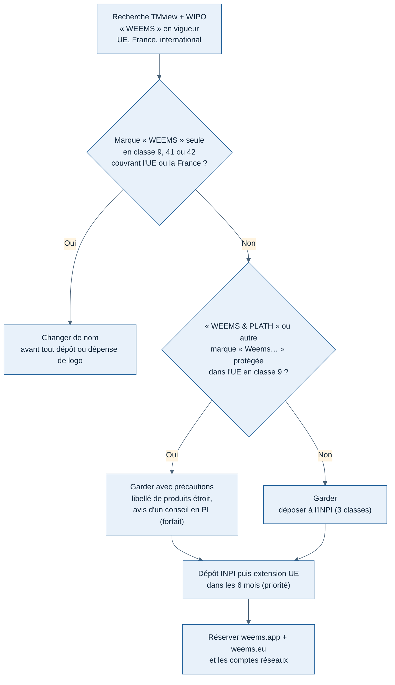

# Vérification du nom « Weems » : risque de marque

Rédigée le 11/11/2026. Prévue par la feuille de route (J4, [lots et feuille de route](../cadrage/04-lots-et-feuille-de-route.md)), avancée pour trancher avant toute dépense sur le logo ([planche logos v1](planche-logos-v1.png)).

> **Ce n'est pas un avis juridique.** C'est un premier tri fait à partir de sources publiques. Avant un dépôt ou une dépense importante sur la marque, la recherche officielle (section 5) reste à faire, et l'avis d'un conseil en propriété industrielle est conseillé si elle trouve quelque chose.

## 1. Conclusion

**Garder « Weems » avec précautions, sous réserve d'une recherche officielle de 15 minutes (section 5)** [Confiance moyenne].

- Aucune marque « WEEMS » seule n'a été trouvée sur des logiciels, des services en ligne ou des jeux [Confiance moyenne : sources américaines secondaires seulement, voir section 2].
- Le seul titulaire sérieux, Weems & Plath, protège « WEEMS & PLATH » pour des instruments de navigation surtout maritimes, pas pour des logiciels [Confiance moyenne].
- Le vrai défaut du nom n'est pas juridique, il est commercial : dans le monde de l'aviation, « Weems » renvoie déjà à P.V.H. Weems (pionnier de la navigation aérienne), à Weems & Plath et à la montre Longines « Weems ». La marque sera faible face aux moteurs de recherche et peu « possédable » [Confiance élevée].
- Les domaines `.com`, `.fr` et `.io` sont pris. `weems.app` et `weems.eu` semblent libres [Confiance moyenne].

**Règle de décision** : si la recherche officielle trouve une marque « WEEMS » seule, en vigueur, couvrant l'UE ou la France, en classe 9, 41 ou 42, on change de nom avant toute dépense. Sinon on garde et on dépose.

## 2. Ce qui a été vérifié, et comment

Les bases officielles (TMview/EUIPO, INPI, USPTO, WIPO Global Brand Database) **n'ont pas pu être interrogées** : elles sont bloquées depuis l'environnement de Claude (cloud et terminal du Mac), et leurs pages exigent JavaScript. Les résultats ci-dessous viennent de répertoires publics qui recopient la base américaine (USPTO) et d'une interrogation DNS des domaines. **Ils ne couvrent ni l'UE ni la France**, ce qui est justement le marché du lot 1. D'où la section 5.

| Source | Couverture | Résultat |
| --- | --- | --- |
| Justia Trademarks, Markinton, Trademarkdir | États-Unis (copie USPTO) | Voir tableau section 3 |
| Recherche web générale | Monde | Aucun logiciel, application ou jeu nommé « Weems » repéré |
| DNS public (Google) | Domaines | Voir section 4 |
| Microsoft Store, réseaux sociaux | — | Non vérifiable automatiquement, à faire à la main |

## 3. Marques et usages proches

| Nom | Titulaire | Classes | Produits | Statut | Gêne pour Weems |
| --- | --- | --- | --- | --- | --- |
| WEEMS & PLATH | Weems & Plath (Annapolis, États-Unis) | Portefeuille en 4, 9, 11, 14, 16, 20 | Instruments de navigation marine, horloges, baromètres, combustible de lampe | 4 marques en vigueur sur 18 déposées aux États-Unis ; présence dans l'UE inconnue | **Moyenne** : même premier mot, univers de la navigation, distribué en Europe |
| CONANT, ROADRULE, LIGHTRULE | Weems & Plath | 9, 14, 16 | Instruments, guides de navigation | Variable | Nulle (noms différents) |
| WEEMSBOX | Société de Guangzhou | 9 | Accessoires électroniques (câbles, coques, montres connectées) | En vigueur aux États-Unis (2021) | **Faible** : classe 9 mais produits matériels, nom composé |
| WEEM | Société de Los Angeles | 5 | Vitamines | En vigueur aux États-Unis (2022) | Nulle (classe sans rapport) |
| Montre « Weems Second-Setting » | Longines (groupe Swatch) | 14 (probable) | Montres d'aviateur | Modèle commercialisé ; dépôt du nom non vérifié | **Faible** juridiquement, **forte** pour la visibilité |
| Weems Industries | Weems Industries (États-Unis) | 6, 7, 8, 9, 17… | Tuyaux, compresseurs (marques Flexzilla, Legacy) | — | Nulle : aucune marque « Weems » à son nom |

### Raisonnement sur Weems & Plath

1. **Similitude des signes** : « WEEMS » est l'élément dominant de « WEEMS & PLATH ». Dans l'UE, un nom de famille repris seul peut suffire à créer un risque de confusion avec une marque composée [Confiance moyenne].
2. **Similitude des produits** : leurs produits sont des instruments physiques de navigation (rapporteurs, compas, baromètres). Nos produits sont un logiciel de suivi de vols simulés, un site et des abonnements. La classe 9 est commune, mais la classe seule ne fait pas la similitude : un instrument de navigation marine et un logiciel de simulation de vol ne visent ni le même usage ni le même client [Confiance moyenne].
3. **Point aggravant** : l'entreprise vient d'une école de navigation aérienne et maritime (1928) et a vendu des rapporteurs d'aviation (« Weems Mark II »). Le lien thématique « navigation » existe.
4. **Point atténuant** : aucun produit logiciel de leur part n'a été trouvé, et leur dépôt américain le plus récent repéré date de 2018.

Bilan : risque d'opposition **faible à moyen** si nous déposons « WEEMS » avec un libellé étroit (logiciels de suivi de vols **simulés**, divertissement), **plus élevé** si nous visons largement « logiciels de navigation » [Confiance moyenne].

## 4. Domaines

Vérification par DNS public le 11/11/2026. Un domaine sans serveur DNS est très probablement libre, mais seul un bureau d'enregistrement le confirme.

| Domaine | État | Commentaire |
| --- | --- | --- |
| weems.com | Pris | Portefeuille de noms de famille (Mailbank/Tucows), rarement vendu, cher |
| weems.fr | Pris | Enregistré chez IONOS |
| weems.io | Pris | Enregistré chez Hover |
| weems.co | Pris | Enregistré chez GoDaddy |
| weems.net | Pris, parqué chez Sedo | Peut-être à vendre |
| **weems.app** | Semble libre | Recommandé (HTTPS obligatoire, cohérent avec une application) |
| **weems.eu** | Semble libre | Recommandé pour le marché UE |
| weems.aero | Semble libre | Réservé aux acteurs de l'aviation réelle : inadapté (projet de simulation) |
| getweems.com, flyweems.com, weemsapp.com | Semblent libres | Solutions de repli en `.com` |

## 5. À faire par Greg (15 minutes, gratuit)

Ces recherches couvrent ce que Claude n'a pas pu voir.

1. **TMview** (UE et France ensemble) : <https://www.tmdn.org/tmview/> → recherche « weems », filtre « Statut : en vigueur », offices « EM » (UE), « FR », « WO » (international). Noter tout résultat en classe 9, 35, 41 ou 42.
2. **WIPO Global Brand Database** : <https://branddb.wipo.int/> → « weems », pour les enregistrements internationaux désignant l'UE.
3. **INPI** : <https://data.inpi.fr/> → onglet Marques, « weems », pour confirmer TMview.
4. **Microsoft Store** : rechercher « Weems » dans l'application Store.
5. **Réseaux** : vérifier les identifiants `weems` sur Instagram, X, YouTube, Discord, Twitch (lieux des passionnés de simulation).

Reporter les résultats en bas de ce document, puis appliquer la règle de décision de la section 1.

## 6. Si on garde le nom : précautions

| Action | Pourquoi | Coût indicatif |
| --- | --- | --- |
| Déposer « WEEMS » (mot seul) à l'INPI en classes 9, 41, 42 | Premier droit en France, à bas prix | 190 € + 2 × 40 € = **270 €** [Confiance élevée] |
| Étendre à l'UE dans les 6 mois (priorité) | Le marché vise l'UE ; la date française est conservée | 850 € + 50 € + 150 € = **1 050 €** [Confiance élevée] ; à décaler jusqu'aux premiers revenus si le budget l'impose |
| Libellé étroit : « logiciels de suivi de vols en simulation », « services de divertissement en ligne », « logiciel en tant que service pour passionnés de simulation » | Écarte les instruments de navigation de Weems & Plath | — |
| Ne jamais évoquer P.V.H. Weems, Weems & Plath ni Longines dans la communication | Éviter toute impression de lien ou de parrainage | — |
| Réserver weems.app et weems.eu, puis les identifiants réseaux | Avant la première communication publique | ~ 30 €/an |
| Classe 35 : inutile pour l'instant | Elle vise la publicité et la gestion pour des tiers, pas notre activité | — |

Le dépôt se fait au nom de la micro-entreprise une fois créée (prévue avant tout revenu, voir [fondamentaux](../cadrage/03-fondamentaux.md)). Le déposer avant sa création, au nom de Greg, est possible puis transférable, mais ajoute une démarche.

## 7. Si on change : pistes de noms

À n'utiliser que si la règle de décision l'impose. **Aucune n'est vérifiée** (marques, domaines) : chacune demanderait la même recherche que ci-dessus. Un nom inventé est plus facile à protéger et à trouver qu'un nom de famille.

| Piste | Idée |
| --- | --- |
| Vectair | Vecteur (navigation) + air |
| Wayline | Ligne de route du FMS, garde le « W » du logo « Waterline » |
| Flyvault | Le coffre de tes vols : carnet et historique |
| Pistelog | Carnet de vol + piste, sonne français |

## 8. Résultats de la recherche officielle

*À compléter par Greg après la section 5.*
