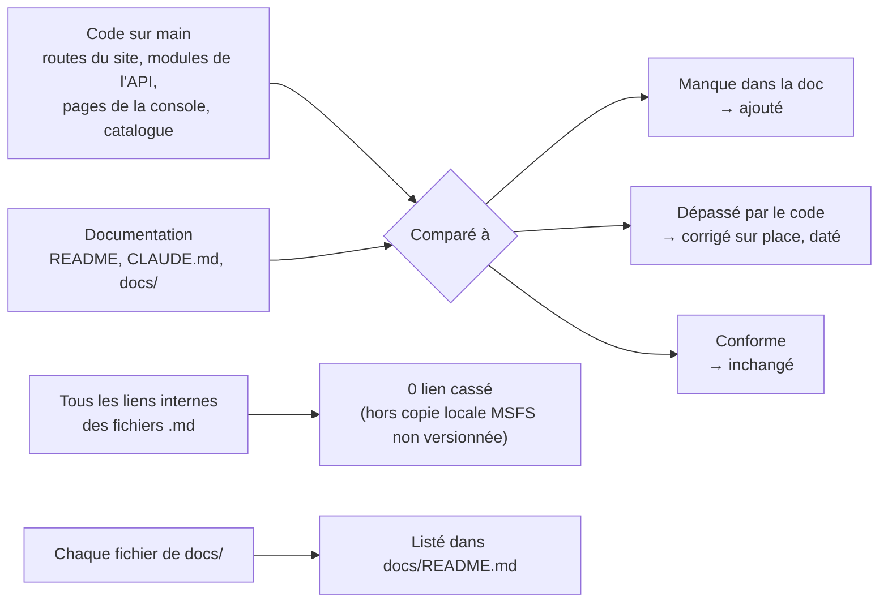

# Mise à jour de la documentation — 13/11/2026

Demande de Greg (12/11/2026, 23 h 44) : mettre toute la documentation à jour avec ce qui a été créé, retirer l'obsolète, ne rien oublier, et vérifier que tout ce qui vaut encore est présent. Point de départ : `main` à 8e7c771 (PR #86). Seule la documentation change : aucun fichier de code.

## En bref

- **La documentation des applications était déjà à jour** : les `CLAUDE.md` de l'API, du site et de la console avaient suivi chaque PR. Les retards étaient dans le `README.md` racine, la feuille de route, le cadrage des formules, la spec du carnet et quelques fiches.
- **Aucun document n'était entièrement obsolète** : rien n'a été déplacé dans `docs/archives/`. Une vingtaine de passages dépassés ont été corrigés sur place, avec leur date, pour garder la trace des décisions. Le dossier `docs/archives/` est créé avec sa règle, pour la suite.
- **Nouveau** : un index de toute la documentation, [`docs/README.md`](../README.md), avec l'état de chaque document.
- **Règles permanentes écrites** : grille des offres tenue à jour à chaque fonction, page Fonctionnalités générée depuis `GET /v1/plans`. Elles sont dans les règles de développement (section 12), le `README.md` et le `CLAUDE.md` racine.
- **Liste Houssine** (`docs/suivi/a-voir-avec-houssine.md`) : gardée, non modifiée, 5 questions ouvertes dont les critères provisoires des repères du carnet.

## Comment la vérification a été faite

Contrôles faits :

| Contrôle | Résultat |
| --- | --- |
| Pages du site (`apps/web/src/app`) comparées à la doc | 18 pages, toutes décrites dans `apps/web/CLAUDE.md` ; README racine en retard (corrigé) |
| Modules de l'API (16) comparés à la doc | Tous décrits dans `apps/api/CLAUDE.md` ; README racine en retard (corrigé) |
| Pages de la console (8) et menu latéral | Pages décrites ; menu de la spec admin dépassé (corrigé) |
| Catalogue des formules (`catalog.ts`) comparé à la fiche 015 | Liste des fonctions disponibles dépassée (corrigée) |
| Images orphelines, schémas sans source ou sans image | Aucun |
| Liens internes de tous les `.md` | Aucun lien cassé après la mise à jour |
| Liste Houssine | Présente et intacte |

## Ce qui a été livré et que la doc reflète maintenant (PR #73 à #86)

| PR | Livré | Où c'est documenté |
| --- | --- | --- |
| #73 | Console : actions des comptes dans une colonne fixe | `apps/admin/CLAUDE.md`, spec admin |
| #74 | Cartes du thème sombre éclaircies | `apps/web/CLAUDE.md` (Stack, carte) |
| #75 | Formules, catalogue dans l'API, page Offres | cadrage 05, fiche 015, `README.md` |
| #76 | Reste à faire du traqueur (`weems://`) | `docs/suivi/reste-a-faire-tracker.md` |
| #77 | Bouton de test Free \| Pro (hors production) | fiche 015, cadrage 05, spec carnet |
| #78 | Texte blanc sur les boutons pleins en thème clair, accent #0c7f94 | spec admin (thème) ; ajouté ce jour |
| #79 | Page Découvrir | `apps/web/CLAUDE.md`, `README.md` |
| #80 | Page Fonctionnalités générée depuis le catalogue | fiche 015, règles de développement § 12, `README.md` |
| #81 | Carnet privé : cadre et Résumé ; `/logbook/public` | spec carnet (§ 8 à jour), fiche 003, spec profil public § 7 |
| #82 | Console : menu resserré, Supervision dans Exploitation | spec admin (barre latérale) ; ajouté ce jour |
| #83 | Carnet : page Vols, fiche, bandes de vol, trajectoire enrichie | spec carnet (§ 7 et 8), `README.md` (tracker, API) |
| #84, #85 | Bouton « Pilot Pro », « Vols en direct » à droite, bannières | fiche 003 (état de la barre), spec accueil |
| #86 | Carnet : page Statistiques | spec carnet, fiche 015, cadrage 05 |

## Changements fichier par fichier

| Fichier | Changement |
| --- | --- |
| `README.md` | Tableau « Organisation » refait (API, site, console, tracker, `packages/ui`) ; « Documents clés » regroupés par thème avec les documents qui manquaient (cadrage 05, carnet privé, accueil, personnalisation, direct enrichi, démarrage Mac, idées) ; nouvelle section « Règles permanentes » ; migrations (`WEEMS_MIGRATE_ON_START`) ; piège `weems-api-1` (conteneur supprimé du Mac le 12/11) ; commande `pnpm populate` ; état de J4 et du lot 2 |
| `CLAUDE.md` (racine) | Index de la doc et règles permanentes |
| `docs/README.md` | **Nouveau** : index de tous les documents avec leur état |
| `docs/archives/README.md` | **Nouveau** : règle d'archivage ; aucun document archivé ce jour |
| `docs/revues/maj-documentation-2026-11-13.md` | **Nouveau** : ce rapport |
| `docs/developpement/regles-de-developpement.md` | Section 12 « Règles permanentes des pages Offres et Fonctionnalités » ; définition de « terminé » renvoie à l'index et aux archives ; section 6 (CI) décrit ce qui existe : J1 filtré par chemins, J2 et J3, flux Windows de l'installateur |
| `docs/cadrage/02-architecture-et-flux.md` | Estimation Scaleway pour l'alpha (12/11, non décidée, ~11-12 €/mois) ; trajectoires dans PostgreSQL, pas S3 |
| `docs/cadrage/03-fondamentaux.md` | Décision « tout en local » du 11/11, 17 h ; environnement local réel (base seule dans Docker) |
| `docs/cadrage/04-lots-et-feuille-de-route.md` | Nouvelle section « État au 13/11/2026 » par jalon ; travail du lot 2 avancé dans le lot 1 ; lot 2 : liste des fonctions déjà dans le catalogue |
| `docs/cadrage/05-formules-abonnement.md` | « Aucun code avant validation » retiré (le code existe) ; état réel : `GET /v1/me/plan` et non `GET /v1/me` ; droits déjà vérifiés par clé dans le carnet |
| `docs/cahiers-des-charges/web/spec-carnet-prive.md` | § 7 : champs ajoutés à `TrackPoint` (fait) ; § 8 : numéros et état des PR (#77, #81, #83, #86 fusionnées ; Objectifs à faire) |
| `docs/cahiers-des-charges/admin/spec-admin.md` | Barre latérale et onglets du téléphone tels qu'ils sont ; accent clair #0c7f94 |
| `docs/cahiers-des-charges/web/spec-J4-accueil.md` | Renvoi vers l'état actuel de la barre (« Créer un compte » remplacé par « Pilot Pro ») |
| `docs/cahiers-des-charges/spec-J4-profil-public.md` | § 7 : `/logbook` est devenu le carnet privé, la page publique vue par son pilote est `/logbook/public` |
| `docs/decisions/003-navigation-barre-flottante.md` | « Créer un compte » marqué remplacé ; « Mon carnet de bord » mis à jour ; nouveau tableau « État de la barre au 13/11/2026 » |
| `docs/decisions/008-modele-de-formulaire.md` | Dock mobile supprimé le 12/11 |
| `docs/decisions/015-catalogue-des-formules.md` | Fonctions disponibles au 13/11 ; carnet en partie livré |
| `docs/suivi/idees-fonctionnalites.md` | L'export du carnet passe dans « Planifiées » (clé `export` du catalogue) ; le rejeu reste une idée |
| `docs/alpha/guide-testeur.md` | Après inscription, le pilote arrive sur « Mon carnet de bord », plus sur « Mes vols » |
| `apps/api/CLAUDE.md` | « Où trouver quoi » : accueil, formules, carnet, supervision et base de données ; Stack : Fastify en place depuis J0, stockage dans PostgreSQL ; notation encore vide |
| `apps/web/CLAUDE.md` | « Où trouver quoi » : règles permanentes, carnet privé, barre, arrondis |
| `packages/notation/README.md` | État réel : paquet vide, critères provisoires dans l'API en attendant un pilote |

## Volontairement laissé tel quel

- **« Mes vols » (`/flights`)** : toujours dans le code et documenté comme tel. Sa suppression au profit du carnet est le travail d'un autre fil ; la doc changera avec cette PR-là.
- **Page complète d'un vol du carnet (maquettes v13), menu principal modernisé, bug thème / langue** : en cours dans d'autres fils, pas encore décidés ni codés, donc absents de la doc.
- **Deux fiches numérotées 011** : gardées pour ne pas casser les liens ; l'index le signale et la prochaine fiche est la 016.
- **Specs des jalons livrés** (J1, J2, J4…) : gardées comme « Référence » (exigences et choix de l'époque) ; le détail du code actuel est dans le `CLAUDE.md` de chaque application.
- **Questions ouvertes** (cadrage 05 section 6, paiement, Thibault, marque) : inchangées, elles attendent une réponse de Greg ou d'un tiers.

## Points qui demandent une décision de Greg (relevés pendant la revue, rien n'a été tranché)

1. **Questions du cadrage 05, section 6** (axes personne / compagnie, plafonds, compagnie gratuite…) : toujours sans réponse, alors que le catalogue et les pages Offres existent.
2. **Fastify / NestJS** dans la liste Thibault : toute l'API est en Fastify depuis J0. Garder la question ouverte n'a plus beaucoup de sens tant que Thibault ne code pas l'API ; à fermer si Greg est d'accord.
