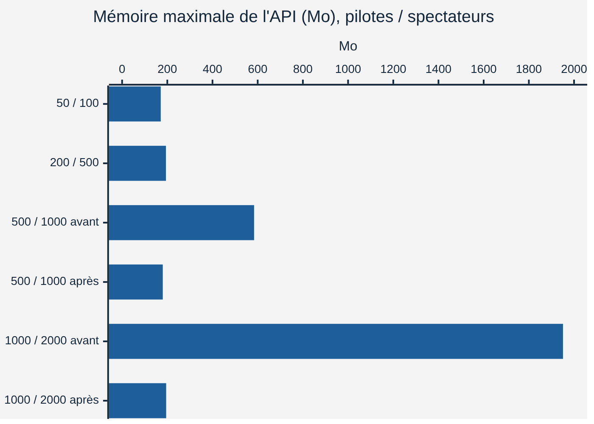
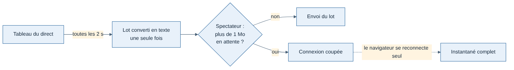

# Mesure de la montée en charge du direct — J4

Faite le 11/11/2026 par Claude, selon la [spécification J4 « montée en charge du direct »](../cahiers-des-charges/api/spec-J4-montee-en-charge-direct.md). Corrections dans la demande de fusion #34.

**Machine** : environnement de Claude (Linux, 4 cœurs, 16 Go), API et générateur dans deux processus, PostgreSQL local. Ce n'est pas encore le Mac de Greg : les commandes pour refaire la mesure sont en fin de document.

## Synthèse

- **Le critère de sortie de J4 est atteint** : paliers 1 (50 pilotes, 100 spectateurs) et 2 (200 pilotes, 500 spectateurs), 30 min chacun, 7 critères sur 7. La bêta (environ 50 pilotes) a une marge d'au moins ×4. [Confiance élevée pour cette machine, moyenne pour le serveur de production]
- **Ce qui cédait en premier : la mémoire de l'API**, à cause de la diffusion. 1,9 Go à 1 000 pilotes et 2 000 spectateurs. Deux causes confirmées et corrigées (H1, H2) : **195 Mo** après correction, à la même charge.
- **H3 et H4 ne sont pas confirmés** : rien n'a été changé.
- **Au-delà de 500 pilotes, c'est le générateur qui sature, pas l'API** (critère 7 en échec). La limite réelle de l'API n'est donc pas encore connue ; on sait seulement qu'elle est au-delà de 1 000 pilotes et 2 000 spectateurs, avec une boucle d'événements à 29 ms au pire.



## Résultats par palier

| Palier | Pilotes / spectateurs | Durée | Résultat | Délai p95 | Réponse API p95 | Boucle API pire p99 | Mémoire max |
| --- | --- | --- | --- | --- | --- | --- | --- |
| Rapide (×10) | 50 / 100 | 6 min | 7 / 7 | 1,9 s | 30 ms | 16 ms | 178 Mo |
| 1 | 50 / 100 | 30 min | 7 / 7 | 1,9 s | 10 ms | 14 ms | 171 Mo (écart 3 %) |
| 2 | 200 / 500 | 30 min | 7 / 7 | 2,1 s | 100 ms | 17 ms | 194 Mo (écart 1 %) |
| 3a avant | 500 / 1 000 | 10 min | mesure invalide (générateur) | 2,5 s | 660 ms * | 22 ms | 584 Mo |
| 3a après | 500 / 1 000 | 10 min | mesure invalide (générateur) | 2,3 s | 600 ms * | 20 ms | 180 Mo |
| 3b avant | 1 000 / 2 000 | 10 min | mesure invalide (générateur) | 9,1 s | 7,2 s * | 47 ms | 1 951 Mo |
| 3b après | 1 000 / 2 000 | 10 min | mesure invalide (générateur) | 5,2 s | 2,3 s * | 29 ms | 195 Mo |
| 3c | 2 000 / 4 000 | — | générateur à court de mémoire | — | — | — | — |

\* Mesuré par le générateur, qui prend du retard lui-même (boucle à 270 ms en 3a, 580 à 860 ms en 3b) : ce temps gonfle les réponses et les délais. Les temps relevés par l'API elle-même dans son journal sont bien plus bas :

| Palier | Réponse aux positions, côté API, p95 par minute |
| --- | --- |
| 3a avant / après | 17 à 23 ms / 15 à 20 ms |
| 3b avant / après | 108 à 212 ms / 36 à 88 ms |

Aucune position perdue et aucun avion figé à aucun palier.

## Hypothèses

| # | Hypothèse | Verdict | Preuve | Correction |
| --- | --- | --- | --- | --- |
| H1 | Le lot est converti en texte une fois par spectateur | **Confirmée** | Mémoire de l'API proportionnelle aux spectateurs : 584 Mo à 1 000, 1 951 Mo à 2 000, puis retour à 35 Mo une fois les spectateurs partis (pas une fuite, des copies) | Lot converti une seule fois, le même texte envoyé à tous (`stream.ts`). Test : `stream-clients.test.ts` compte les conversions. 1 951 → 195 Mo |
| H2 | Un spectateur qui ne lit plus fait grossir la mémoire | **Confirmée** | 20 spectateurs bloqués (connexion ouverte, rien lu) avec 300 pilotes à ×10 : la mémoire monte sans fin, de 136 à 360 Mo en 4 min (environ +1,5 Mo/s) | Spectateur avec plus de 1 Mo en attente coupé ; le navigateur se reconnecte seul et reçoit l'instantané. Même essai après : les 20 sont coupés en 2 min environ, mémoire stable à 186 Mo. Test : `stream-clients.test.ts` |
| H3 | Une vague de reconnexions coûte cher (instantané reconstruit à chaque connexion) | Non mesurée à part, rien vu | Les 2 000 spectateurs du palier 3b se connectent en quelques secondes sans retard notable de la boucle de l'API | Aucune |
| H4 | Une lecture en base à chaque position | Non confirmée | Côté API, réponse p95 sous 25 ms à 500 pilotes ; à 1 000 pilotes, le reste du temps vient surtout du processeur partagé avec le générateur | Aucune. À remesurer quand le générateur ne sera plus la limite |



## Corrections du générateur de charge

La mesure du palier 3 a d'abord échoué côté générateur, pas côté API :

1. **Mémoire du générateur** : chaque vol synthétique complet pèse environ 4 Mo, et les N vols étaient construits d'avance (2 Go pour 500 pilotes). Chaque pilote est maintenant construit à son départ, avec seulement la partie jouée avant l'arrêt (`tools/simulate/simulation.ts`, `replayUntil`).
2. **Critère 6 (mémoire)** : jugé seulement sur une mesure de 20 min ou plus. Sur 30 s (test de la CI), l'écart mesurait le démarrage de l'API, pas une fuite. Le rapport l'indique « non mesurée ».

Limite qui reste : le générateur fait tourner tous les pilotes et tous les spectateurs dans un seul processus. Il sature à partir de 500 pilotes et 1 000 spectateurs sur cette machine, et manque encore de mémoire à 2 000 pilotes. Pour trouver la vraie limite de l'API, il faudra répartir la charge sur plusieurs processus. Ce n'est pas nécessaire pour la bêta.

## Refaire la mesure sur le Mac

Onglet 1 (API) :

```
cd ~/Projets/weems-code
git fetch origin && git switch claude/project-thread-kpe5np && git pull
pnpm install
cd apps/api
docker compose up -d db
pnpm dev
```

Onglet 2 (charge, palier 1, 30 min) :

```
cd ~/Projets/weems-code
pnpm load --pilots 50 --viewers 100 --minutes 30
```

Palier 2 : `--pilots 200 --viewers 500`. Mesure rapide (6 min) : `--speed 10 --minutes 6`. Le rapport s'affiche à la fin, une ligne par critère, avec le chemin du fichier de détail ; `Palier réussi` attendu aux paliers 1 et 2.
