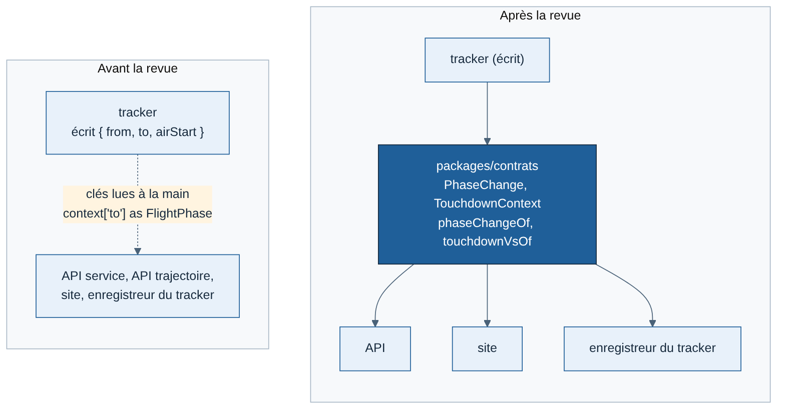

# Revue de structure — fin de J3

Faite le 11/11/2026 par Claude, comme le demandent les [règles de développement](../developpement/regles-de-developpement.md) (section 4, « revue de structure complète à la fin de chaque jalon »). C'est la première : les revues de fin de J0, J1 et J2 n'avaient pas été écrites. Elle couvre donc tout le code de `main` après la fusion de #31.

Corrections dans la demande de fusion #33, un commit par sujet.

## Synthèse

- **Le code est bien rangé.** Aucun fichier au-delà de 300 lignes, aucune dépendance interdite, aucun doublon détecté, aucun code mort. L'organisation réelle suit les `CLAUDE.md` des trois applications. [Confiance élevée]
- **Un problème bloquant, hors code : `main` était rouge** depuis la fusion de #30. #31 a été fusionnée malgré cela. Corrigé.
- **Trois défauts de structure que les outils ne voyaient pas**, tous corrigés : une règle de frontière incomplète, une lecture des événements dispersée en sept endroits, une fonction mal rangée.
- **Statut du jalon** : le code de J3 est terminé, mais **le critère de sortie de J3 n'est pas atteint** (5 pilotes, 50 vols sur la machine Hetzner). Il attend la mise en ligne, reportée par Greg. On peut avancer sur J4 en local ; J3 reste ouvert sur le papier.

## Contrôles automatiques

| Contrôle | Résultat |
| --- | --- |
| Types (`pnpm typecheck`) | OK |
| Style (`pnpm lint`) | OK |
| Frontières (dependency-cruiser) | OK, mais règle du cœur du tracker incomplète (voir 2) |
| Doublons (jscpd, 70 jetons minimum) | 0 doublon ; les petites répétitions passent sous le seuil (voir 3) |
| Code inutilisé (knip) | OK |
| Tests unitaires et d'API | 310 sur 310 avant, 315 après la revue |
| Tests J1, J2, J3 de bout en bout | OK en local après la revue |
| Intégration continue sur `main` | **Rouge sur les deux dernières fusions** (voir 1) |

## Constats et corrections

| # | Constat | Gravité | Correction |
| --- | --- | --- | --- |
| 1 | CI rouge sur `main` depuis #30 : `playwright install --with-deps` réinstalle des polices par apt, le miroir Ubuntu ne répondait plus (10 min puis échec). Les tests J2 et J3 n'ont plus tourné. | Haute | Installation du navigateur sans `--with-deps` (l'image `ubuntu-24.04` a déjà les bibliothèques de Chrome), délai de 5 min sur l'étape. Contrôle de santé PostgreSQL sur `weems_test` (fin du bruit « database weems does not exist ») |
| 2 | La règle « le cœur du tracker ne dépend de rien » listait les dossiers interdits un par un. `account/` et `runtime/`, ajoutés en J3, y échappaient. | Moyenne | La règle interdit tout le tracker hors de `core/` (`tools/` compris). Vérifiée en ajoutant un import interdit : elle échoue bien |
| 3 | Le contexte d'un événement est libre. Sept endroits (API, site, tracker) lisaient `context["to"]`, `["from"]`, `["airStart"]` ou `["vs"]` chacun à sa façon, dont un transtypage non vérifié dans l'enregistreur du tracker. Un renommage côté tracker aurait cassé l'API et le site sans erreur de type. | Moyenne | Définition unique dans `packages/contrats/src/flight/event-context.ts`, utilisée par l'écrivain et tous les lecteurs (schéma ci-dessous). Format échangé inchangé |
| 4 | `distanceNm` vivait dans `core/recovery.ts` ; le générateur de vols importait la reprise après crash pour mesurer une route. | Faible | Déplacée dans `core/geo.ts` |
| 5 | `architecture-interne.md` ignorait `runtime/`, `account/` et `tools/fly/`, et attribuait la règle du cœur à ESLint. | Faible | Document et schéma des modules mis à jour |

## Points relevés, sans correction maintenant

| Point | Pourquoi on attend |
| --- | --- |
| `packages/notation` n'existe que sous forme de `README`, alors que les `CLAUDE.md` y renvoient pour le calcul de la note | Il attend les critères de notation (point 4 de la spec T0), qui demandent un pilote. Documenté comme « à créer » |
| Le contexte des événements reste libre à la réception par l'API (`z.record`) : un contexte inattendu est stocké sans erreur | Le valider à l'entrée, type par type, change le contrat : à faire quand on touchera le format des événements (débriefing de J4). Les lecteurs, eux, sont désormais sûrs |
| Le lancement du navigateur est écrit deux fois dans les tests J2 et J3 (`e2e/`, hors du périmètre de jscpd) | Quatre lignes ; à regrouper si un troisième test navigateur arrive |
| `#31` fusionnée avec une CI rouge | Rappel de la règle : on ne fusionne que sur CI verte. La protection de `main` ne l'a pas empêché : à vérifier dans les réglages du dépôt (fusion seulement si la CI est verte, sans exception pour l'administrateur) |

## Ce que la revue n'a pas fait

- Pas de revue de sécurité complète (`/security-review`) : elle a été faite à chaque demande de fusion de J3 qui touchait la connexion.
- Pas de mesure de performance : c'est le sujet « montée en charge du direct » de J4.
