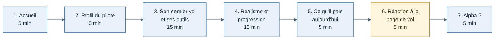

# Guide d'entretien pilotes

Rédigé le 11/11/2026. À utiliser avec les 5 pilotes trouvés par Houssine, **avant l'alpha (J3)**, et idéalement avant la fin de J1. Les fondateurs de compagnies virtuelles auront leur propre guide avant le lot 3.

## Pourquoi

Le positionnement de Weems repose sur l'étude des concurrents, pas sur des pilotes. Ces entretiens vérifient trois hypothèses avant d'investir dans l'alpha :

| Hypothèse | Ce qui la confirme | Ce qui la contredit |
| --- | --- | --- |
| H1 — Les trackers actuels ne disent pas au pilote **comment** il a volé, seulement **où** | Le pilote cherche lui-même à évaluer son vol (taux d'atterrissage, vidéos, forums) et trouve ça insuffisant | Il ne regarde jamais rien après l'atterrissage |
| H2 — Être jugé sur les règles réelles (approche stabilisée, 250 kt sous le niveau 100) intéresse | Il cite des règles réelles qu'il essaie de respecter | Il vole pour se détendre et rejette toute notation |
| H3 — Une partie des pilotes paie déjà pour le réalisme | Il paie déjà Navigraph, des avions payants, un abonnement | Il n'a jamais rien payé au-delà du simulateur |

**Seuil de décision** : si au moins 3 pilotes sur 5 confirment H1 et H2, le positionnement tient. Sinon, on revoit la différenciation avant l'alpha.

## Règles de conduite

- **Parler du passé, pas du futur.** « Racontez-moi votre dernier vol » vaut plus que « Aimeriez-vous un tracker qui note vos vols ? ». À la seconde, tout le monde répond oui.
- **Ne pas présenter Weems avant la partie 6.** Sinon le pilote répond pour faire plaisir.
- **Demander des exemples précis.** « La dernière fois que… », « Montrez-moi… ».
- **Écouter plus que parler** : environ 80 % du temps de parole pour le pilote.
- **Noter les mots exacts** du pilote, pas une interprétation.
- **Accord du pilote** pour prendre des notes. Les comptes rendus sont anonymisés (« Pilote 1 ») avant d'être rangés dans le dépôt.

## Déroulé (45 minutes, en visio ou en vrai)

### 1. Accueil (5 min)

- Remercier, expliquer : « Je prépare un outil pour les pilotes de simulation. Je ne vends rien aujourd'hui, j'ai besoin de comprendre comment vous volez. Il n'y a pas de mauvaise réponse. »
- Demander l'accord pour prendre des notes.

### 2. Profil du pilote (5 min)

1. Depuis quand volez-vous en simulation ? Sur quel simulateur et quelle version ?
2. Combien de vols par mois, et de quelle durée en général ?
3. Quels avions ? Lesquels sont payants ?
4. Volez-vous en ligne (VATSIM, IVAO) ? Dans une compagnie virtuelle ?
5. Avez-vous une expérience de pilote réel, ou un projet de le devenir ?

### 3. Son dernier vol et ses outils (15 min)

6. Racontez-moi votre dernier vol, de la préparation jusqu'à l'arrêt des moteurs.
7. Qu'avez-vous fait juste après avoir coupé les moteurs ?
8. Quels outils utilisez-vous autour du vol : préparation, suivi, carnet de vol ? Pourquoi celui-là ?
9. La dernière fois que vous avez regardé un vol passé, qu'est-ce que vous cherchiez ?
10. Qu'est-ce qui vous agace dans ces outils ? Racontez-moi la dernière fois.
11. Avez-vous déjà changé de tracker ? Pourquoi ?

### 4. Réalisme et progression (10 min)

12. Comment savez-vous si un vol était « bien » ?
13. Y a-t-il des règles réelles que vous essayez de respecter ? Lesquelles ?
14. Avez-vous déjà raté une approche ou fait une remise des gaz ? Comment l'avez-vous vécu ?
15. Le taux d'atterrissage : vous le regardez ? Qu'en faites-vous ?
16. Qu'est-ce qui vous ferait confiance, ou non, dans une note donnée à votre vol ?

### 5. Ce qu'il paie aujourd'hui (5 min)

17. Pour quoi avez-vous payé en simulation l'an dernier ? Combien, à peu près ?
18. Avez-vous un abonnement en cours (Navigraph, autre) ? Pourquoi celui-là ?
19. Avez-vous déjà arrêté un abonnement ? Pourquoi ?

### 6. Réaction à la page de vol (5 min)

Montrer seulement le schéma de la [page de vol](../schemas/img/web-page-de-vol.png) et celui des [12 phases](../schemas/img/tracker-phases.png).

20. Qu'est-ce que vous regarderiez en premier ? Et ensuite ?
21. Qu'est-ce qui manque pour vous ?
22. Qu'est-ce qui ne vous servirait à rien ?

### 7. Alpha (5 min)

23. Accepteriez-vous de tester le tracker sur une dizaine de vols, dans quelques semaines ?
24. Configuration : Windows 10 ou 11, MSFS 2020 ou 2024, avions habituels, connexion internet stable ?
25. Connaissez-vous d'autres pilotes qui accepteraient d'en parler ?

## Après l'entretien

Remplir la fiche dans les 24 heures, tant que c'est frais, dans `docs/suivi/entretiens/pilote-N.md` :

| Rubrique | À noter |
| --- | --- |
| Profil | Expérience, simulateur, avions, fréquence, en ligne ou non, compagnie |
| Citations | 3 à 5 phrases exactes, les plus parlantes |
| H1, H2, H3 | Confirmée, contredite ou sans avis, avec la phrase qui le montre |
| Page de vol | Ce qu'il regarde en premier, ce qui manque, ce qui est inutile |
| Alpha | Oui ou non, configuration |
| Surprise | Ce qu'on n'attendait pas |

Après les 5 entretiens, Claude rédige une synthèse : hypothèses confirmées ou non, priorités pour la page de vol, liste de l'alpha, et ce qu'il faut changer dans les documents.
