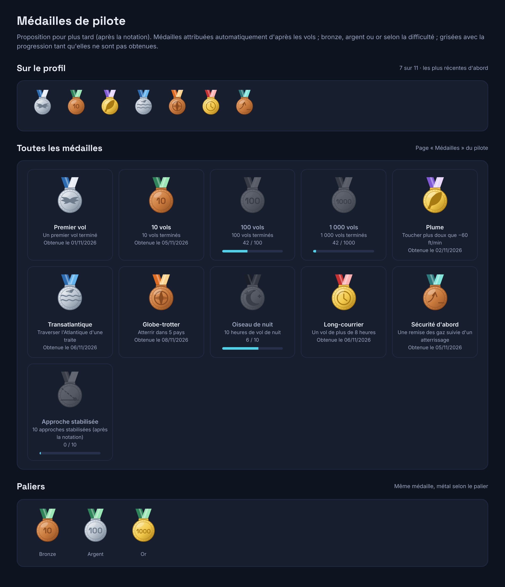

# Idées de fonctionnalités pour plus tard

Liste tenue à jour au fil du projet : idées validées sur le principe par Greg, sans lot ni date. Quand une idée entre dans un lot, la déplacer dans « Planifiées » avec le lien vers sa spécification.

## En attente

- **Niveau Weems** (ajouté le 11/11/2026, profil public)
  Heures de vol par catégorie d'avion (léger, turbopropulseur, ligne, hélicoptère), calculées à partir des vols, affichées sur le profil à côté du niveau déclaré par le pilote. Plus crédible que le niveau déclaré, car mesuré.
  Prérequis : le catalogue des avions (type, catégorie) prévu au cadrage (`docs/cadrage/02-architecture-et-flux.md`), pas encore construit.

- **Médailles de pilote** (ajouté le 11/11/2026, profil public ; remplacent les « badges », choix de Greg)
  Médailles illustrées (ruban et médaille en bronze, argent ou or selon la difficulté), attribuées automatiquement d'après les vols : premier vol, 10, 100 et 1 000 vols, plume (toucher très doux), transatlantique, globe-trotter, oiseau de nuit (heures de nuit), long-courrier, sécurité d'abord (remise des gaz suivie d'un atterrissage), approche stabilisée… Les médailles non obtenues apparaissent grisées avec la progression. Sur le profil : les plus récentes et un lien vers la page de toutes les médailles.
  Prérequis : la notation (point 4 de la spec T0) pour les médailles de pilotage (approche stabilisée, etc.).

  

- **Signaler une photo de profil** (ajouté le 11/11/2026, profil public)
  Bouton « signaler » sur le profil public et retrait par Weems. À faire avant l'inscription libre.

- **Suivre un pilote, fil d'activité** (ajouté le 11/11/2026, profil public)
  Suivre d'autres pilotes et voir leurs derniers vols dans un fil.

- **Rejeu d'un vol et export PDF du carnet** (ajouté le 11/11/2026)
  À garder pour l'abonnement pilote (lot 2).

- **Heures en ligne VATSIM et IVAO** (ajouté le 11/11/2026, profil public)
  Lues depuis les données publiques des deux réseaux, à partir des identifiants du profil. Vérifier leurs conditions d'usage.

## Planifiées

- **Compagnies du pilote sur son profil** : lot 3 (VACommunity). Emplacement montré sur la maquette du profil public.
